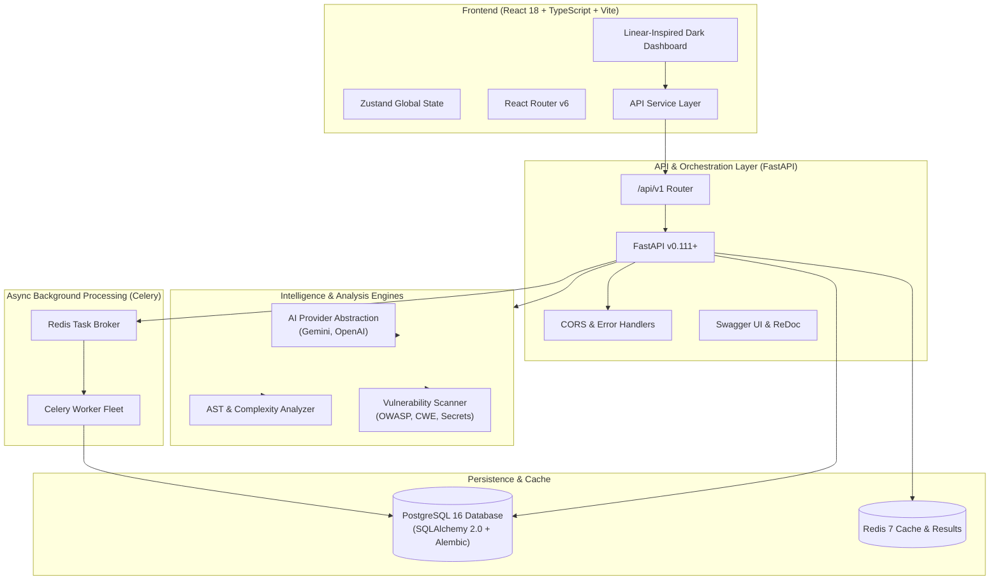

# DevPilot Architecture Overview

DevPilot is a modular, production-ready AI-powered software development and code intelligence platform designed for deep repository comprehension, vulnerability detection, and automated architectural mapping.

## System Architecture Diagram

## Layer Responsibilities

### 1. Presentation Layer (`frontend/`)
- Built with React 18, TypeScript, Tailwind CSS, and Framer Motion.
- Dark, Linear-inspired design language utilizing charcoal surfaces (`#0C0E14`, `#12151E`) with subtle borders and restrained blue-violet accents (`#6366F1`, `#8B5CF6`).
- Single source of UI truth via Zustand stores with responsive navigation, global search palette (`Ctrl+K`), and live health monitoring.

### 2. API Gateway & Core Service (`backend/app/`)
- Modular FastAPI application with structured routing at `/api/v1`.
- Typed request validation and serialization with Pydantic v2.
- Centralized exception handlers for graceful error responses.
- Database access through SQLAlchemy 2.0 declarative base and connection pooling.
- Alembic database migration management.

### 3. Intelligence Engines (`backend/app/engines/`)
- `ai/`: Provider-agnostic abstraction (`BaseAIProvider`) supporting Google Gemini, OpenAI GPT, and future local models.
- `analyzer/`: Abstract syntax tree (AST) traversal, cyclomatic and cognitive complexity computation, and static rule verification.

### 4. Background Workers & Integration (`backend/app/workers/`, `app/integrations/`)
- Celery worker architecture communicating over Redis brokers for non-blocking repository cloning, scanning, and graph generation.
- Dedicated GitHub API client for future OAuth2 and Webhook synchronization.
